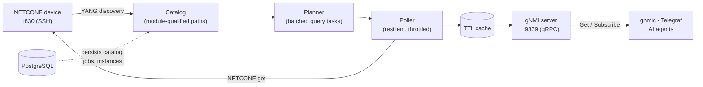
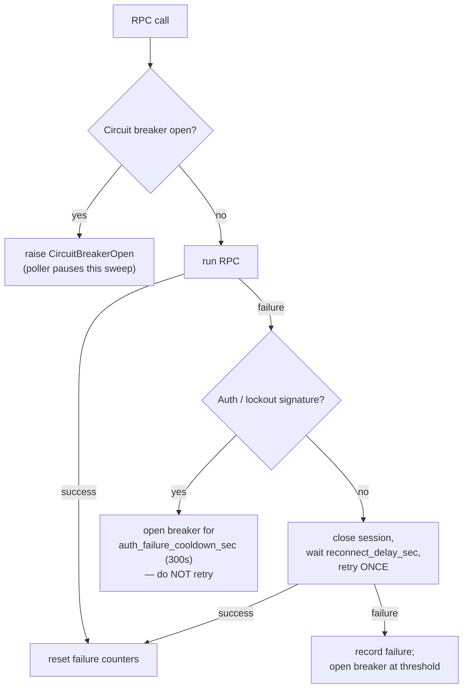
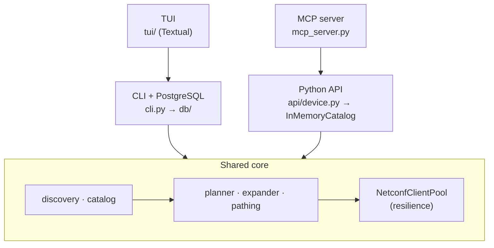

# Architecture

Splice turns a NETCONF device into a standard gNMI server by discovering its YANG models, building a telemetry catalog, planning efficient batched reads, polling them through a resilience layer, and answering gNMI from a TTL cache. This page is the mental model: the end-to-end pipeline, the four ways to drive it, and the design choices — especially connection resilience — that make it safe to point at fragile optical hardware.

## The pipeline at a glance



The flow has two phases:

1. **Discovery (one-time / on setup)** — connect over NETCONF (SSH, port 830), read the device's YANG library, fetch the schemas, and compile them into module-qualified **catalog paths**. With the CLI stack this is persisted to PostgreSQL; with the Python API it lives in an in-memory catalog.
2. **Runtime (continuous)** — a gNMI request (or a polling job) resolves to a catalog path, the **planner** turns catalog entries into batched NETCONF filters, the **poller** executes them through the resilience layer, parsed values land in a **TTL cache**, and the gRPC server answers `Get`/`Subscribe` from that cache.

!!! note "Why a cache sits between gNMI and NETCONF"
    gNMI clients expect low-latency reads and subscriptions; NETCONF `<get>` over SSH is comparatively slow and the devices throttle concurrent sessions. The poller fills the cache on its own schedule and the gRPC server reads from it, decoupling client request rate from device RPC rate.

## Stage by stage

### Discovery: YANG to catalog paths

Discovery walks the device's advertised YANG modules, fetches each schema, and `build_catalog` (in `catalog.py`, driven by `runtime.run_build_catalog_with_paths`) compiles them into a flat set of **canonical paths** — every leaf and keyed list, qualified by its YANG module prefix (for example `/org-openroadm-device/node-id`). Each catalog entry carries the `filter_xml` the poller will send and the originating `module`.

The shared discovery steps live in `runtime.py` and are reused by both the all-in-one `setup` command and the individual CLI commands:

| Step (`runtime.py`) | What it does |
|---|---|
| `run_discovery` | Enumerate YANG modules from the device, store them |
| `run_fetch_yang` | Download each schema to `yang_dir`, skipping ones already on disk |
| `run_build_catalog_with_paths` | Compile YANG into canonical catalog paths |
| `run_build_aliases` | Derive namespace-free alias paths (unique per device) |
| `run_init_jobs` | Create polling jobs for catalog paths at the default interval |

!!! warning "Fetching YANG is lockout-aware"
    `run_fetch_yang` throttles between RPCs (default `0.3s`), skips files already downloaded, and **fails fast on authentication errors** rather than retrying — a repeated auth failure can lock the device account. It also caps consecutive failures (default 10) to avoid a reconnect storm, and reconnects once between failures when given a `reconnect_fn`.

### Planner: batching reads to spare the device

Polling every catalog path with its own `<get>` would mean thousands of RPCs against a device that may cap concurrent sessions. The **planner** (`planner.py`) coalesces them. A `QueryTask` pairs a `canonical_path` with the `filter_xml` to send and an `interval_sec`. Three planning strategies are available:

| Function | Coalescing key | Use |
|---|---|---|
| `plan_queries` | none (one task per path) | Simplest, most RPCs |
| `plan_batched_queries` | top-level container | Fewer RPCs — one task per root subtree |
| `plan_module_batched_queries` | `(module, top-level container)` | One task per module subtree |

When several children of one container have different intervals, the coalesced parent is polled at the **fastest (minimum)** of them — one task per target, never one task per `(target, interval)`:

```python
# plan_batched_queries: children of /interfaces with intervals 5s and 30s
# collapse to a single task fetching /interfaces every 5s, not two tasks.
```

`group_tasks_by_interval` then buckets the resulting tasks by interval so the poller can run each interval group on its own cadence.

### Poller: one resilient sweep loop

The `NetconfPoller` (`netconf/poller.py`) runs a single daemon thread that, for each interval group whose time has come, sweeps its tasks: `fetch(filter_xml)` → `parse(xml)` → `ingest(updates)`. Key behaviors:

- **Per-task throttle** — sleeps `task_throttle_sec` between tasks within a sweep so it never fires RPCs back-to-back.
- **Task failure breaker** — after `task_failure_limit` consecutive failures a single task is dropped from rotation for the process lifetime (re-enabled on restart or task refresh). `0` disables this.
- **Circuit-breaker pauses don't count against tasks** — when the underlying pool's breaker is open, the sweep pauses and any buffered per-task failures for that sweep are discarded, so a device-wide outage never wrongly disables otherwise-healthy paths.
- **Sweep stats** — per-interval `ok`/`fail`/`disabled`/`duration`/`paused_by_circuit_breaker`, surfaced through the `/health` endpoint and `splice status`.

`update_tasks` lets the runtime swap the task list live (after jobs are re-enabled or PM filters rebuilt on drift); a refreshed list is treated as a clean slate that clears stale failure history.

### Parsing: XML to keyed key-value paths

`parse_xml_to_kv` (also in `poller.py`) converts a NETCONF reply into `{path, value, timestamp_ns, meta}` records. It walks the XML, and when given `list_keys` it inlines list-key predicates read from each element's own children — so a reply containing many instances of the same list yields distinct, correctly attributed paths (`/interfaces/interface[name=eth0]/state/mtu`) instead of collapsing onto the last key seen. Values are cast to the YANG type (`int*`, `uint*`, `decimal64`/`float`, `boolean`) when a `type_map` is supplied.

### Cache and gNMI server

Parsed updates are ingested into a TTL cache that the gRPC server (`gnmi_server.py`) answers from, doing path matching against the catalog. See [Configuration](configuration.md) for the `cache` TTL and `gnmi` server settings.

## Connection resilience (the load-bearing design)

Optical and transport gear is unforgiving: many devices **limit concurrent NETCONF sessions** and **lock the account after repeated auth failures**. Every RPC path in Splice is therefore built to back off rather than hammer. The resilience lives in `NetconfClientPool` (`netconf/client.py`), which wraps a single-session `NetconfClient`.



### Reconnect-once

On an RPC failure the pool closes the dead session, waits `reconnect_delay_sec` (default `2.0s`), reconnects, and retries the RPC **exactly once**. If the retry also fails the error propagates immediately — there are no retry loops that could storm the device. The reconnect sleep happens with the pool lock released, so other threads (a concurrent Set, the health endpoint) aren't blocked.

### Circuit breaker

A circuit breaker tracks consecutive failures across all callers. After `circuit_breaker_threshold` consecutive failures (default `5`) the pool refuses new RPCs for `circuit_breaker_cooldown_sec` (default `60s`), raising `CircuitBreakerOpen`. When the cooldown expires, one attempt is allowed through to probe recovery.

### Auth / session-limit detection

This is the critical safety valve. `_is_auth_error` matches not just authentication rejections but **device-side access and session-limit conditions** — these all share the property that retrying makes them *worse* (account lockout, session exhaustion). Matched signatures include vendor-specific wording such as `access denied`, `too many sessions`, `session limit`, `permission denied`, `lock-denied`, and `license limit`. Any of these **immediately** opens the breaker for the longer `auth_failure_cooldown_sec` (default `300s`) and skips the retry entirely.

!!! tip "Tuning for your device"
    These thresholds are configurable in the `poller` section of the config. On a device with very tight session limits, raise the cooldowns and lower the threshold. See [Configuration](configuration.md) and [Troubleshooting](troubleshooting.md) for symptoms (empty `gnmic` responses often mean the poller is in an auth/session-limit backoff).

### Throttling layers, top to bottom

| Layer | Mechanism | Default |
|---|---|---|
| Discovery | `run_fetch_yang` inter-RPC sleep | `0.3s` |
| Poller | `task_throttle_sec` between tasks in a sweep | `0.05s` |
| Pool | `reconnect_delay_sec` after a failure | `2.0s` |
| Pool | circuit-breaker cooldown | `60s` |
| Pool | auth/session-limit cooldown | `300s` |

`get_status` exposes the live breaker state (`consecutive_failures`, `auth_failure_count`, `circuit_breaker_open`, `circuit_breaker_seconds_remaining`) without taking the pool lock, so `/health` never blocks behind an in-flight poll.

## Path and catalog model

### Canonical, alias, and keyed paths

- **Canonical paths** are YANG module-qualified: `/p1:components/p1:component`. They are what discovery produces and what the planner and poller use.
- **Alias paths** strip the module prefixes for convenience: `/components/component`. `normalize_path` (`pathing.py`) drops the `prefix:` on each segment; `run_build_aliases` ensures aliases are unique per device.
- **Keyed list paths** carry their list keys as predicates, normalized by key with percent-encoded values: `/interfaces/interface[name=eth0]`. Key values are URL-encoded (`encode_key_value`) so values containing slashes or special characters survive — note that values containing `[` or `]` are rejected as unsafe during expansion.

`is_path_prefix` does boundary-aware prefix matching (a descendant continues with `/` or `[`), so `/system` never spuriously matches `/system-backup`.

### Expansion modes

Keyed lists must be expanded into concrete instances before they can be polled or matched. `expander.py` does this from `list_keys` (which leaves key a list) and `list_instances` (the discovered key values), taking the cartesian product across nested lists. Expansion is **guarded**: `expand_path_guarded` estimates the product size first and **skips** (returns a `skipped` result with a reason) when it would exceed `max_per_base` (default `10000`), preventing a cartesian explosion from a deeply nested list.

When the expansion happens is controlled by `gnmi.expansion_mode`:

| Mode | Behaviour |
|---|---|
| `direct` | Use cached list instances only (default, safe) |
| `full` | Fresh discovery of instances on every `run` start |
| `lazy` | Like `direct`, but expand on first gNMI request |

!!! warning "`full` is slow on real hardware"
    `full` re-discovers every list instance at startup, which on a session-throttled device can take a long time. Prefer `direct` in production and re-run discovery deliberately when the device's inventory changes.

### Where PM (performance-monitoring) data fits

Performance-monitoring counters do **not** map onto YANG catalog paths. Instead they are published under synthetic, instance-keyed paths:

```
/pm/{domain}[<instance keys>]/{name}/{mon_type}
```

The instance keys are discovered from the reply XML's ancestors (key leaves such as `name`, `entity-name`, `index`, `id`) and rendered as a single bracket with comma-joined, alphabetically sorted, percent-encoded values — the same canonical form a client query produces, so lookups compare equal. This keeps per-port metrics from colliding when many ports report the same counter name. PM details (filter fanout, drift detection) are covered in [Configuration](configuration.md).

## The four usage stacks

Splice exposes the same NETCONF/catalog/planner/poller core through four front ends.



### 1. CLI + PostgreSQL

The production stack: `cli.py` drives a service layer that persists the catalog, jobs, list instances, and PM filters to PostgreSQL. Config is YAML, one file per device, supporting multiple devices (one gNMI server instance and port per device, sharing the database via `device_id` foreign keys). This is the only stack that requires a database. See the [Configuration](configuration.md) reference and [Deployment](deployment.md) guide.

### 2. Python API (`InMemoryCatalog`)

`api/device.py` exposes a `Device` class that runs the whole pipeline with **no database and no config files** — all state lives in an in-memory catalog dataclass. Ideal for scripts, notebooks, and tests:

```python
from splice.api.device import Device

with Device("sim://openroadm") as dev:
    print(dev.get("/org-openroadm-device/node-id"))
```

Full reference in [Python API](python-api.md).

### 3. MCP server

`mcp_server.py` wraps the Python API as MCP tools over stdio for AI agents (Claude and others) — connect, query telemetry, search paths, and push config as tools. It adds session management, rate limiting, a deny-all-by-default set policy, and a structured error taxonomy. No database required. See [API](api.md).

### 4. TUI

`tui/` is a Textual-based interactive console (`splice-tui --devices-dir devices`) that sits on top of the CLI/database stack: browse catalog paths, watch live telemetry, run `setup`/`run` as managed subprocesses, and monitor health and circuit-breaker state. See the [TUI Guide](tui.md).

## Where to go next

- [Quickstart](quickstart.md) — point Splice at your first device.
- [Configuration](configuration.md) — every config section, including the `poller` resilience knobs quoted above.
- [Python API](python-api.md) — the database-free `Device` class.
- [TUI Guide](tui.md) — the interactive operator console.
- [Troubleshooting](troubleshooting.md) — diagnosing backoff, lockouts, and empty responses.
