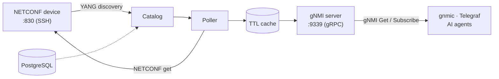

# Splice

**Point at a NETCONF device's IP, get a working gNMI server.**

*Vendor-agnostic telemetry for optical and network gear that never spoke gRPC.*

---

Modern telemetry collectors — gnmic, Telegraf, OpenConfig pipelines — expect **gNMI** over gRPC. But a huge amount of deployed optical and transport gear only speaks **NETCONF**: ROADMs, transponders, amplifiers, line systems. Each vendor ships its own YANG models, its own list keys, its own quirks.

**Splice fixes that.** Give it an IP and credentials; it discovers the device's YANG models, builds a telemetry catalog, polls NETCONF under the hood, and serves standard gNMI to any client — no per-vendor code, no changes to the device.


*Three different vendors — Lumentum ROADM, Adtran Teraflex, Juniper ILA — streaming optical power into one Grafana dashboard through Splice.*

!!! tip "No hardware? No problem."
    Everything below works against a built-in simulated device. Run `splice --simulate openroadm run` and point any gNMI client at `localhost:9339`. See [Simulation](simulation.md).

## How It Works



Discovery walks the device's YANG library into module-qualified catalog paths, the planner batches them into efficient NETCONF reads, and a resilient poller fills a TTL cache that the gRPC server answers from. Performance-monitoring data is published under synthetic, instance-keyed paths so per-port metrics never collide.

For the full picture — the three usage stacks, the layered design, and the data flow — see the **[Architecture](architecture.md)** overview.

## Key Features

| | Feature | Description |
|---|---|---|
| 🧭 | **Zero-touch onboarding** | `quickstart --host <ip>` discovers YANG, builds the catalog, and serves gNMI in one command |
| 🏷️ | **Vendor-agnostic** | Works across any NETCONF/YANG device — proven live on Lumentum, Adtran, and Juniper gear |
| 🔑 | **Instance-keyed telemetry** | PM data carries its originating port as gNMI keys, so multi-line metrics stay distinct |
| 🔁 | **Drift self-healing** | Re-resolves list instances at startup and rebuilds filters when a device is re-provisioned |
| 🩺 | **Lockout-safe resilience** | Reconnect-once, circuit breaker, and auth/session-limit detection protect fragile devices |
| 🎯 | **Curated polling** | Poll only the metrics you care about with include patterns and per-pattern intervals |
| 📊 | **Grafana dashboards out of the box** | Setup generates per-device live-telemetry and YANG-inventory dashboards from the catalog |
| 🔎 | **Hybrid path search** | Find paths in huge YANG catalogs by keyword (BM25) blended with semantic embeddings |
| 🧪 | **Hardware-free simulation** | `--simulate openroadm` runs the full pipeline against a simulated device |
| 🤖 | **AI-agent ready** | Built-in MCP server exposes the bridge as tools for Claude and other agents |

!!! note "Resilience is the load-bearing design choice"
    Optical devices frequently limit concurrent NETCONF sessions and lock accounts on repeated auth failures, so every RPC path is built to back off rather than hammer. See [Observability & Resilience](observability.md).

## Four Ways to Use It

| Interface | Entry point | Best for |
|---|---|---|
| **CLI + PostgreSQL** | `splice --config <cfg> setup \| run` | Production: persistent catalog, multi-device, history |
| **Python API** | `Device("sim://openroadm")` | Scripting and notebooks — no database or config files |
| **MCP server** | `splice mcp` | AI agents — connect, query, and set config as tools |
| **Interactive TUI** | `splice-tui --devices-dir devices` | Operators — browse paths, watch live telemetry, run setup |


*The Textual console managing a live Adtran Teraflex — health cards, circuit-breaker state, and catalog counts at a glance.*

## Get Started

The fastest path is two steps: **[Installation](quickstart.md)** then **[Quickstart](quickstart.md)**.

Try it right now, no hardware required:

```bash
python -m venv .venv && source .venv/bin/activate
pip install -e .
splice --simulate openroadm run
```

In another terminal, it answers gNMI like any real server:

```bash
gnmic -a localhost:9339 --insecure capabilities
# gNMI version: 0.8.0
# supported models:
#   - org-openroadm-device, 2023-05-26  ...
```

Then point it at a real device:

```bash
NETCONF_PASSWORD='...' splice quickstart --host 10.0.0.1 --username admin
```

This generates a per-device config, runs full discovery, writes Grafana dashboards for the device, and starts the gNMI server. That's the whole promise — an IP in, a gNMI endpoint out.

!!! example "Read live values from Python — no DB, no config files"
    ```python
    from splice.api.device import Device

    with Device("sim://openroadm") as dev:
        print(dev.get("/org-openroadm-device/node-id"))
        # [{'path': '/org-openroadm-device/node-id', 'value': 'ROADM-SIM-01'}]
    ```

## Dig Deeper

Explore the feature you need:

- **[Architecture](architecture.md)** — the three usage stacks, layered design, and data flow
- **[CLI Reference](cli.md)** — every `splice` command, flag, and the full setup pipeline
- **[Querying telemetry](querying-gnmi.md)** — gNMI Get / Subscribe, path conventions, and keyed lists
- **[MCP server](mcp.md)** — the AI-agent tool set, set policy, and error taxonomy
- **[Simulation](simulation.md)** — run the whole pipeline against a simulated device
- **[Performance monitoring](performance-monitoring.md)** — instance-keyed PM paths, fanout filters, and drift
- **[Path search](path-search.md)** — hybrid BM25 + semantic search over huge YANG catalogs
- **[Observability & Resilience](observability.md)** — health endpoint, circuit breaker, Grafana dashboards

And the guides for each interface:

- **[Quickstart](quickstart.md)** — bring up your first device in minutes
- **[Docker + Grafana Quickstart](noob_guide.md)** — full telemetry stack with one compose file
- **[Python API](python-api.md)** · **[API Reference](api.md)** — drive Splice from scripts and notebooks
- **[TUI Guide](tui.md)** — the interactive operator console
- **[Configuration](configuration.md)** — every config section, with examples
- **[Deployment](deployment.md)** · **[Troubleshooting](troubleshooting.md)** — run it for real, and fix it when it breaks

## Licensing

Splice is **dual-licensed**:

1. **GNU AGPL v3.0-or-later** (see [`LICENSE`](https://github.com/Open-Ireland-Testbed/splice/blob/main/LICENSE)) — free for open-source and AGPL-compliant use. If you modify Splice or run it as a network service, the AGPL requires you to make your corresponding source available to its users.
2. **Commercial licence** — for proprietary, embedded, or closed-source use without the AGPL's copyleft obligations. See [`COMMERCIAL-LICENSE.md`](https://github.com/Open-Ireland-Testbed/splice/blob/main/COMMERCIAL-LICENSE.md) for a summary.

If you use Splice in a closed-source or commercial product, you must obtain a commercial licence. To request one, contact Trinity College Dublin (Trinity Innovation & Enterprise) at **infoknex@tcd.ie**.

Copyright (c) 2026 Trinity College Dublin. For the architecture overview aimed at contributors and agents, see [CLAUDE.md](https://github.com/Open-Ireland-Testbed/splice/blob/main/CLAUDE.md).

---

*Built for the [Open Ireland](https://openireland.eu) optical testbed — so any NETCONF device can join a modern telemetry pipeline.*
